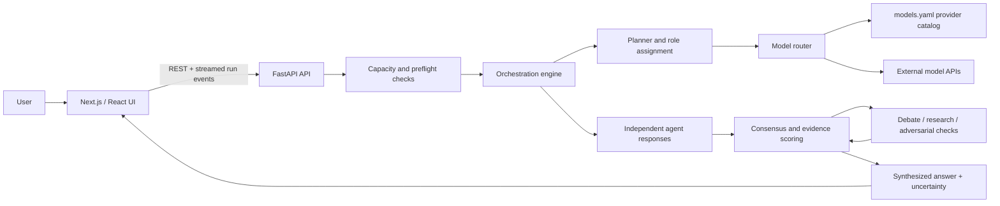

# Assembly

Assembly is an experimental multi-agent AI workspace. Give it a question and a time budget, and it coordinates a temporary team of AI agents that work independently, examine disagreements, and produce a synthesized answer with sources and uncertainty notes where available.

Assembly is a research project, not a promise of correctness. Multiple models can share the same blind spots, citations may be incomplete, and a confident-looking consensus can still be wrong.

## What Assembly does

A typical run goes through these stages:

1. **Plan:** estimate the task and choose agent roles for the available time and configured models.
2. **Solve independently:** selected agents work on the problem before seeing one another's answers.
3. **Compare and challenge:** Assembly scores agreement, evidence, confidence, contradictions, and new information. If useful, agents debate, research, or run an adversarial check.
4. **Synthesize:** the system combines the results into one answer and exposes remaining uncertainty.

Execution budgets currently include 3, 5, 10, and 15 minutes. Actual results depend on model availability, configured keys, quotas, latency, and the question.

## Who it is for

Assembly is for developers, researchers, and curious users who want to experiment with model diversity, structured debate, evidence checks, and multi-agent orchestration. It is also for contributors interested in Python APIs, frontend UX, provider integrations, testing, documentation, privacy, and reliability.

**Do not rely on Assembly as the sole source for medical, legal, financial, security-critical, emergency, or other high-stakes decisions.** Always independently verify important claims.

## Architecture at a glance

The web UI is a Next.js static-export frontend. It talks to a FastAPI backend, which coordinates agents and calls external model and optional search providers.



- **Frontend:** Next.js, React, TypeScript, and Tailwind CSS under `frontend/`.
- **Backend:** FastAPI and Python under `src/`; the API exposes catalog, preflight, key-testing, and streamed run endpoints.
- **Orchestration:** planner, agent manager, model router, consensus, debate, research, and synthesis modules.
- **Configuration:** `models.yaml` is the source of truth for configured provider/model IDs, roles, families, and quota metadata.
- **Storage:** web mode is designed to be stateless on the server, apart from in-memory run coordination. Development and desktop modes use local SQLite. The browser can persist key configuration, so use only a trusted local build and protect your browser profile.
- **Desktop:** Tauri-related code exists in the repository, but the quickest contributor path to verify is the web frontend plus FastAPI backend described below.

## Quick start

### Prerequisites

- Python 3.11 or newer
- Node.js 20 or newer and npm
- Git

Run the backend and frontend in separate terminals.

### 1. Clone and prepare Python

Once the repository is public, clone it with:

```bash
git clone https://github.com/anubhab7105/Assembly.git
cd Assembly
python -m venv .venv
```

Activate the virtual environment:

```bash
# macOS / Linux
source .venv/bin/activate

# Windows PowerShell
.venv\Scripts\Activate.ps1
```

Install application and development dependencies:

```bash
python -m pip install --upgrade pip
python -m pip install -r requirements-dev.txt
cp .env.example .env
```

On Windows PowerShell, use `Copy-Item .env.example .env` instead of `cp`.

Generate a fresh local quota salt:

```bash
python -c "import secrets; print(secrets.token_hex(32))"
```

Copy the output into `QUOTA_SALT` in your local `.env` file. Do not commit `.env`. The example file intentionally does not contain a real secret.

Apply local database migrations and start FastAPI:

```bash
alembic upgrade head
uvicorn src.main:app --reload
```

The backend should be available at `http://localhost:8000`. In development, the API docs are at `http://localhost:8000/docs`.

### 2. Start the frontend

Open a second terminal in the cloned repository directory, then run:

```bash
cd frontend
npm ci --legacy-peer-deps
npm run dev
```

If your backend is not at the default `http://localhost:8000`, set `NEXT_PUBLIC_API_URL` in `frontend/.env.local` to the backend base URL (without a trailing slash). The default already targets local FastAPI.

Open [http://localhost:3000](http://localhost:3000).

### 3. Configure model access

Assembly follows a **Bring Your Own Keys (BYOK)** model. Add working provider keys in the application's Settings UI and follow its readiness checks. For local development, you can also configure server-side keys in `.env`; never use production credentials in test runs or screenshots. Provider names, model IDs, free quotas, and rate limits change frequently, so check the live provider dashboard and `models.yaml` before relying on a configuration.

### Run tests

See [CONTRIBUTING.md](CONTRIBUTING.md) for the full test and pull-request workflow. At a minimum:

```bash
# From the repository root
alembic upgrade head
pytest

# From frontend/
npm run lint
npx tsc --noEmit
npx playwright test
```

## Current limitations

- **Experimental quality:** there is no claim that consensus is objectively correct or that the system has been validated for high-stakes use.
- **External dependencies:** model and search APIs can rate-limit, return errors, change models, or be unavailable. Free-tier terms and quotas are controlled by each provider.
- **Model diversity:** distinct families can reduce some shared failure modes, but they do not guarantee independent reasoning or factual accuracy.
- **Credential hygiene:** never commit API keys, paste them into issues, or include them in logs and screenshots. Browser-persisted keys should be treated as sensitive local data.
- **Desktop maturity:** desktop packaging and sidecar behavior may not be as straightforward to reproduce as the documented web development path.
- **Performance and test coverage:** large or long-running tasks can be slow; not every provider/model combination is exercised against live APIs in CI.

## Ways to contribute

You don't have to build a new agent to make Assembly better. High-impact contributions include:

- **Reliability:** improve retry/fallback behavior, cancellation, streaming, quota handling, and clear error messages.
- **Evaluation:** add offline tests, replay fixtures, reproducible benchmarks, and evidence-quality checks.
- **Provider support:** improve catalog validation and adapter behavior without hard-coding model IDs outside `models.yaml`.
- **UX and accessibility:** improve keyboard navigation, mobile layouts, progress visibility, onboarding, and privacy explanations.
- **Security and privacy:** strengthen key handling, redaction, safe defaults, dependency review, and threat-model documentation.
- **Docs and developer experience:** make setup clearer, reduce first-run friction, and add small reproducible examples.

Five focused contributor tasks are open:
- **Frontend and UX** — [#9, a good first issue](https://github.com/anubhab7105/Assembly/issues/9): responsive layout, accessibility, chat interactions, execution progress, and Playwright coverage.
- **Model provider integrations** — [#10](https://github.com/anubhab7105/Assembly/issues/10): adapter behavior, quotas, rate-limit recovery, and model configuration.
- **Testing and evaluation** — [#11](https://github.com/anubhab7105/Assembly/issues/11): expand tests and compare Assembly with individual-model baselines using a documented protocol.
- **Security and reliability** — [#12](https://github.com/anubhab7105/Assembly/issues/12): test key privacy, error recovery, and concurrency boundaries.
- **Documentation** — [#8](https://github.com/anubhab7105/Assembly/issues/8): keep setup, API contracts, architecture diagrams, and troubleshooting current.

Start with one small, reproducible improvement. If you have a different idea, open an issue to discuss its scope before investing in a large change.

## Project documentation

- [Contributor guide](CONTRIBUTING.md) — development setup, checks, and pull requests.
- [Security policy](SECURITY.md) — private vulnerability reporting and credential handling.
- [Code of Conduct](CODE_OF_CONDUCT.md) — community expectations and enforcement.
- [Documentation index](docs/README.md) — architecture and design notes.
- [Architecture detail](docs/architecture.md) — components, run pipeline, state, and storage boundaries.
- [Execution workflow](docs/WORKFLOW.md) — the intended run lifecycle.
- [Tech stack notes](docs/TECH_STACK.md) — implementation choices and historical design context.

## License

Assembly is distributed under the Apache License 2.0. See [LICENSE](LICENSE).
