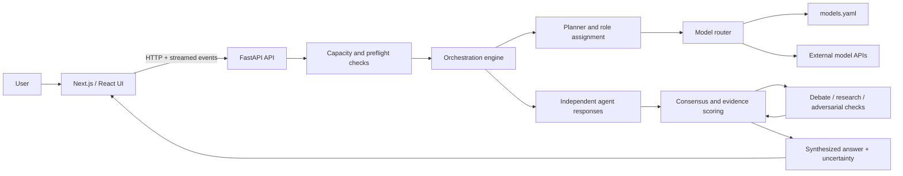

# Assembly

Assembly is an experimental, open-source multi-agent AI workspace. Give it a question and a time budget, and it coordinates a temporary team of AI agents that work independently, compare evidence, challenge disagreement, and synthesize an answer with sources and uncertainty notes where available.

Assembly is a research project, not a promise of correctness. Multiple models can share the same blind spots, citations may be incomplete, and apparent consensus can still be wrong. Do not rely on Assembly as the sole source for medical, legal, financial, security-critical, emergency, or other high-stakes decisions; independently verify important claims.

## What it does

A typical investigation follows this path:

1. **Plan:** Estimate the task and choose agent roles within the requested time budget and available model capacity.
2. **Solve independently:** Selected agents create first-pass responses before seeing one another's answers.
3. **Compare and challenge:** Assembly scores agreement, evidence, confidence, contradictions, and new information. When useful, agents debate, research, or run an adversarial check.
4. **Synthesize:** The system combines results into a final answer and surfaces remaining uncertainty.

Available time budgets are 3, 5, 10, and 15 minutes. Actual results depend on configured models, provider quotas, latency, API availability, and the question being asked.

## Architecture at a glance

The web UI is a Next.js frontend. It communicates with a FastAPI backend that coordinates agents, calls external model providers, and streams run progress.



- **Frontend:** Next.js, React, TypeScript, and Tailwind CSS in `frontend/`.
- **Backend:** FastAPI and Python in `src/`.
- **Orchestration:** planning, model routing, independent solving, consensus scoring, challenge rounds, research, and synthesis.
- **Provider catalog:** `models.yaml` defines configured model IDs, provider/family metadata, roles, and quota information.
- **Web storage:** the backend is designed to be stateless for run data. Questions, answers, attachment content, and provider keys are handled in memory for active requests. Browser history and settings may be stored locally in browser storage.
- **Desktop/dev storage:** local SQLite may be used for desktop/development execution history. Desktop provider keys use the OS credential-store integration; they do not belong in SQLite or plain files.
- **Windows app:** the `desktop/` directory contains the Tauri 2 shell and Python sidecar packaging workflow.

See [the architecture guide](docs/architecture.md) for component details and exact data boundaries.

## Quick start: web development

### Requirements

- Python 3.11 or newer
- Node.js 20 or newer and npm
- Git

### 1. Clone and prepare Python

```bash
git clone https://github.com/anubhab7105/Assembly.git
cd Assembly
python -m venv .venv
```

Activate the virtual environment:

```bash
# macOS / Linux
source .venv/bin/activate

# Windows PowerShell
.venv\Scripts\Activate.ps1
```

Install backend and development dependencies, and create a local environment file:

```bash
python -m pip install --upgrade pip
python -m pip install -r requirements-dev.txt
cp .env.example .env
```

On Windows PowerShell, use `Copy-Item .env.example .env` instead of `cp`.

Generate a unique local quota salt:

```bash
python -c "import secrets; print(secrets.token_hex(32))"
```

Put the generated value in `QUOTA_SALT` inside your local `.env`. Never commit `.env` or real credentials. Keep the sample placeholders in `.env.example`.

### 2. Start FastAPI

From the repository root:

```bash
alembic upgrade head
uvicorn src.main:app --reload
```

The API should be available at [http://localhost:8000](http://localhost:8000). In development, the interactive API documentation is at [http://localhost:8000/docs](http://localhost:8000/docs).

Local development mode may use SQLite for local history. The deployed web mode is designed not to persist run data on the server.

### 3. Start the frontend

In a second terminal:

```bash
cd frontend
npm ci --legacy-peer-deps
npm run dev
```

Open [http://localhost:3000](http://localhost:3000). By default, the frontend targets the local FastAPI backend at `http://localhost:8000`. To override it, set `NEXT_PUBLIC_API_URL` in `frontend/.env.local` to the backend base URL without a trailing slash.

Running the frontend alone does not provide model execution; the backend must also be running.

### 4. Configure model access

Assembly uses a **Bring Your Own Keys (BYOK)** model. Add your provider keys in the application's Settings UI and follow its readiness checks. Never commit keys, paste them into issues, or include them in logs and screenshots. Browser-persisted keys are sensitive local data; protect your browser profile and device.

Provider names, available models, terms, quotas, and limits change frequently. Confirm the provider's current documentation/dashboard and the repository's `models.yaml` before relying on an entry. Providers receive the prompt content needed to complete a request and apply their own data-handling policies.

## Windows desktop app

The desktop application uses Tauri 2 with a bundled Python backend sidecar. The app can keep execution history on the local machine and uses the OS credential-store integration for provider keys.

Read the [desktop development guide](desktop/README.md) and the [Windows release guide](docs/windows-release.md) before building an installer. Packaging and clean-Windows verification are environment-dependent; do not assume a successful web build means the desktop installer has been tested.

## Run checks

Run checks relevant to your changes before opening a pull request. From the repository root:

```bash
alembic upgrade head
pytest
```

From `frontend/`:

```bash
npm run lint
npx tsc --noEmit
npm test
npx playwright install chromium
npx playwright test
npm run audit:high
npm run build
```

Prefer deterministic tests with mock/replay providers. Live provider calls and packaged Windows smoke tests are separate environment-dependent checks; document what you did and did not run. See [CONTRIBUTING.md](CONTRIBUTING.md) for the detailed workflow.

## Current limitations

- **Experimental quality:** the consensus score is a heuristic, not a calibrated probability of correctness; the project is not validated for high-stakes use.
- **Provider dependencies:** external model and search APIs may rate-limit, fail, change available models, or alter free-tier terms.
- **Model diversity:** different model families can reduce some shared failure modes but cannot guarantee independent reasoning or factual accuracy.
- **Privacy boundaries:** prompt content sent to a provider is subject to that provider's policies. Browser storage is not a server backup and may be accessible to same-origin scripts running in the profile.
- **Attachments:** v1 accepts bounded UTF-8 text files only. PDF, DOCX, image parsing, and OCR are not supported; see [attachment documentation](docs/attachments.md).
- **Desktop maturity:** release packaging, OS credential storage, and installer behavior need environment-specific Windows verification.
- **Evaluation:** benchmark results must be presented with their methodology, data provenance, grading status, and limitations. Demo/synthetic results are not evidence of real-world model performance.

## Contributing

Contributions that improve reliability, privacy, accessibility, reproducibility, evaluation, provider integrations, documentation, and developer experience are welcome. Start with one focused, reproducible change. Search open issues and pull requests before starting larger work, and open an issue to discuss significant changes.

Useful current areas include:

- [Frontend and UX — #9](https://github.com/anubhab7105/Assembly/issues/9): improve chat, navigation, accessibility, responsive layout, and execution progress.
- [Benchmark methodology — #11](https://github.com/anubhab7105/Assembly/issues/11): improve reproducible comparisons against individual-model baselines.
- [Verified benchmark results — #18](https://github.com/anubhab7105/Assembly/issues/18): run and publish real, graded evaluation results.
- [Windows release pipeline — #19](https://github.com/anubhab7105/Assembly/issues/19): complete packaging and clean-machine verification.
- [Security regression matrix — #20](https://github.com/anubhab7105/Assembly/issues/20): cover key privacy, API boundaries, and failure paths with focused tests.
- [Markdown documentation sweep — #22](https://github.com/anubhab7105/Assembly/issues/22): remove stale setup guidance and align documentation with the implementation.

Read [CONTRIBUTING.md](CONTRIBUTING.md) before submitting code or documentation. Contributors should use forks and pull requests rather than pushing directly to the main repository.

## Project documentation

- [Documentation index](docs/README.md)
- [Architecture](docs/architecture.md)
- [Product requirements](docs/PRD.md) — current requirements and design intent
- [Execution workflow](docs/WORKFLOW.md)
- [Tech stack](docs/TECH_STACK.md)
- [Privacy](docs/privacy.md)
- [Security and prompt-injection defense](docs/security.md)
- [Threat model](docs/threat-model.md)
- [File attachments](docs/attachments.md)
- [Windows release guide](docs/windows-release.md)
- [Decision log](docs/decisions.md)
- [Contributor guide](CONTRIBUTING.md)
- [Security policy](SECURITY.md)
- [Code of Conduct](CODE_OF_CONDUCT.md)

## License

Assembly is distributed under the Apache License 2.0. See [LICENSE](LICENSE).
