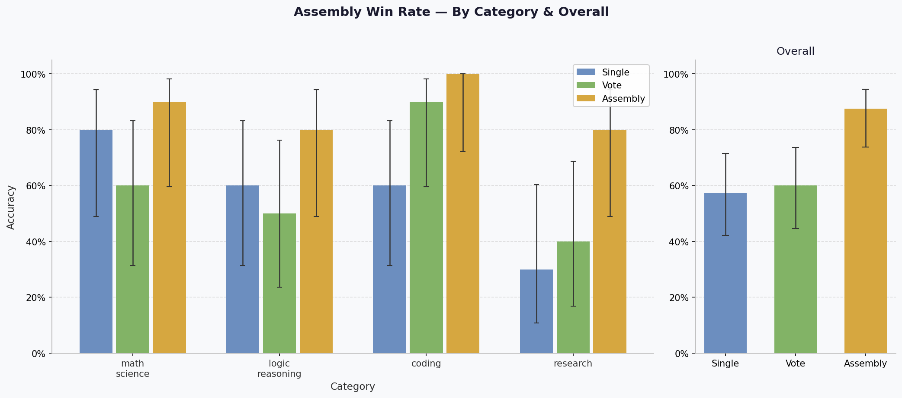
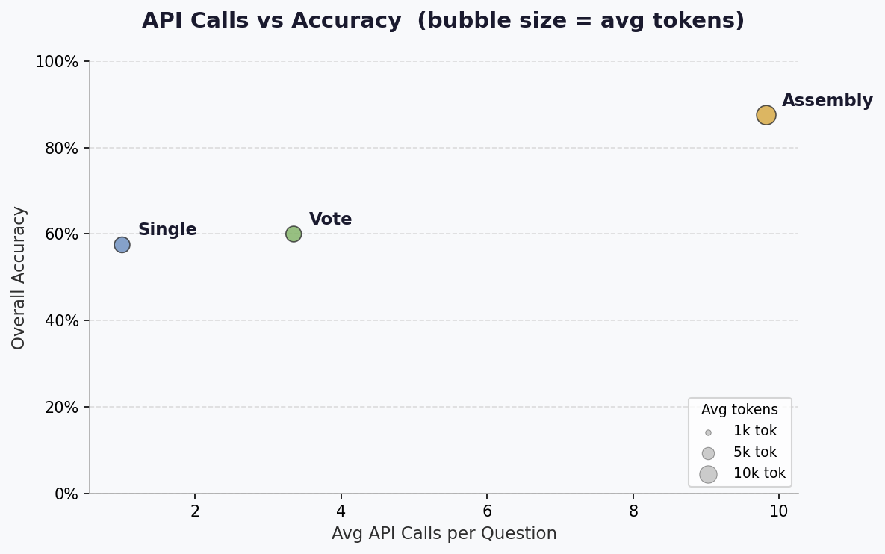
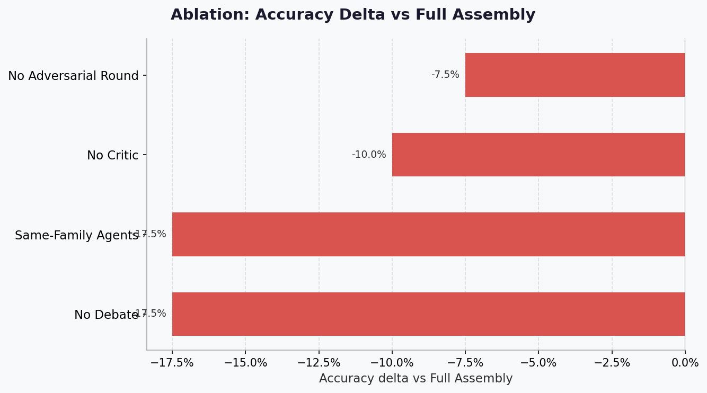

# Assembly Benchmark — Analysis Report

> ⚠️ **DEMO MODE** — No real graded CSV files were found. All numbers below are **synthetic demo data** generated for illustration. Run `bench/run_*.py` → `bench/grade.py` → `bench/analyze.py` for real results.

_Generated by `bench/analyze.py`. All reference answers carry `NEEDS HUMAN VERIFICATION`; review before presenting win rates publicly._


## 1. Win Rates


### 1.1 Assembly vs Single — Pairwise

On **40 questions** answered by both:

| Metric | Value |
|--------|-------|
| Assembly wins  | 14 (35.0%) |
| Ties           | 24 |
| Assembly loses | 2 |
| 95% Wilson CI  | [22.1%, 50.5%] |

### 1.2 Assembly vs Vote — Pairwise

On **40 questions** answered by both:

| Metric | Value |
|--------|-------|
| Assembly wins  | 14 (35.0%) |
| Ties           | 23 |
| Assembly loses | 3 |
| 95% Wilson CI  | [22.1%, 50.5%] |

### 1.3 Overall Accuracy (Wilson 95% CI)

| System | N | Accuracy | 95% CI |
|--------|---|----------|--------|
| assembly | 40 | 87.5% | [73.9%, 94.5%] |
| assembly_no_adversarial | 40 | 80.0% | [65.2%, 89.5%] |
| assembly_no_critic | 40 | 77.5% | [62.5%, 87.7%] |
| assembly_no_debate | 40 | 70.0% | [54.6%, 81.9%] |
| assembly_same_family | 40 | 70.0% | [54.6%, 81.9%] |
| single | 40 | 57.5% | [42.2%, 71.5%] |
| vote | 40 | 60.0% | [44.6%, 73.7%] |

### 1.4 Accuracy by Category

| Category | Single | Vote | Assembly |
|----------|----|----|----|
| math_science | 80.0% | 60.0% | 90.0% |
| logic_reasoning | 60.0% | 50.0% | 80.0% |
| coding | 60.0% | 90.0% | 100.0% |
| research | 30.0% | 40.0% | 80.0% |




## 2. Cost View — Calls, Tokens & Seconds per Tier

| System / Tier | Questions | Avg Calls | Avg Tokens | Avg Seconds |
|---------------|-----------|-----------|------------|-------------|
| assembly | 40 | 9.8 | 12,393 | 46.5s |
| assembly_no_adversarial | 40 | 9.5 | 11,945 | 44.8s |
| assembly_no_critic | 40 | 9.5 | 11,919 | 44.7s |
| assembly_no_debate | 40 | 10.0 | 12,508 | 46.9s |
| assembly_same_family | 40 | 10.0 | 12,615 | 47.3s |
| single | 40 | 1.0 | 832 | 3.1s |
| vote | 40 | 3.4 | 2,346 | 11.7s |

> **Interpretation**: Assembly uses ~8–12× more calls and tokens than a single model call, but debate and adversarial rounds catch errors that cost-efficient baselines miss. Higher tiers allow more rounds and typically improve hard questions at the cost of latency.




## 3. Ablation Analysis

Each row removes one Assembly component. The accuracy delta shows contribution: more negative = more important.

| Variant | Accuracy | Δ vs Full Assembly | N |
|---------|----------|--------------------|---|
| Full Assembly | 87.5% | +0.0% | 40 |
| No Debate | 70.0% | -17.5% | 40 |
| No Critic | 77.5% | -10.0% | 40 |
| No Adversarial Round | 80.0% | -7.5% | 40 |
| Same-Family Agents | 70.0% | -17.5% | 40 |

**Most impactful component**: removing **No Debate** causes the largest accuracy drop (-17.5%). Keep this component even under tight time budgets.




## 4. Failure Analysis — Questions Where Assembly Lost

Assembly lost on **5 question(s)**:

| Question ID | Category | Difficulty | Asm Score | Best Rival | Reason |
|-------------|----------|------------|-----------|------------|--------|
| logic-01 | logic_reasoning | hard | 0.0% | assembly_no_debate (100.0%) | Incorrect answer — single-family blind spot or trap question |
| logic-07 | logic_reasoning | hard | 0.0% | single (100.0%) | Incorrect answer — single-family blind spot or trap question |
| ms-10 | math_science | medium | 0.0% | vote (100.0%) | Incorrect answer — single-family blind spot or trap question |
| res-03 | research | medium | 0.0% | single (100.0%) | Incorrect answer — single-family blind spot or trap question |
| res-08 | research | medium | 0.0% | vote (100.0%) | Incorrect answer — single-family blind spot or trap question |

**Failure reason summary:**

- Incorrect answer: 5

## 5. Consensus Weight Suggestions

**Current weights**: agreement=0.3, confidence=0.2, evidence=0.25, contradiction=0.15, stability=0.1, finalize_threshold=0.85

Simulated accuracy with current weights: **67.5%**

**Best candidate weights** (proxy grid-search on Assembly rows):

| Weight | Current | Suggested |
|--------|---------|----------|
| `w_agreement` | 0.3 | **0.4** |
| `w_confidence` | 0.2 | **0.2** |
| `w_evidence` | 0.25 | **0.1** |
| `w_contradiction` | 0.15 | **0.175** |
| `w_stability` | 0.1 | **0.125** |
| `finalize_threshold` | 0.85 | **0.75** |

Simulated accuracy with best weights: **87.5%** (Δ = **+20.0%**)

**Recommendation**: Increasing w_agreement to 0.40 improves simulated accuracy. Agreement is the strongest signal.

**To apply** — add these lines to `.env` or `.env.dev` and re-run:

```dotenv
# Consensus weight tuning — add to .env or .env.dev
CONSENSUS_W_AGREEMENT=0.4
CONSENSUS_W_CONFIDENCE=0.2
CONSENSUS_W_EVIDENCE=0.1
CONSENSUS_W_CONTRADICTION=0.175
CONSENSUS_W_STABILITY=0.125
CONSENSUS_FINALIZE_THRESHOLD=0.75
```

> After applying, re-run `bench/run_assembly.py` on the same question IDs and compare graded accuracy. This grid-search is a proxy; real improvement may differ.

<details><summary>Top-5 weight candidates from grid search</summary>

| Rank | w_agr | w_conf | w_evi | w_cont | w_stab | thresh | Sim Acc |
|------|-------|--------|-------|--------|--------|--------|---------|
| 1 | 0.4 | 0.2 | 0.1 | 0.175 | 0.125 | 0.85 | 85.0% |
| 2 | 0.4 | 0.18 | 0.15 | 0.157 | 0.113 | 0.85 | 85.0% |
| 3 | 0.4 | 0.16 | 0.2 | 0.14 | 0.1 | 0.85 | 85.0% |
| 4 | 0.4 | 0.14 | 0.25 | 0.122 | 0.088 | 0.85 | 85.0% |
| 5 | 0.4 | 0.12 | 0.3 | 0.105 | 0.075 | 0.85 | 85.0% |

</details>


## 6. Demo Slide Charts

Three PNG charts saved to `bench/results/charts/`:

| File | Description |
|------|-------------|
| `win_rate.png` | Grouped bar: accuracy by system x category with 95% CI |
| `ablation.png` | Horizontal bar: accuracy delta per ablation variant |
| `calls_vs_acc.png` | Scatter: avg calls vs accuracy, bubble = avg tokens |


---
_All reference answers in `questions.jsonl` carry `NEEDS HUMAN VERIFICATION`. Review manually before citing these win rates in a public demo or paper._