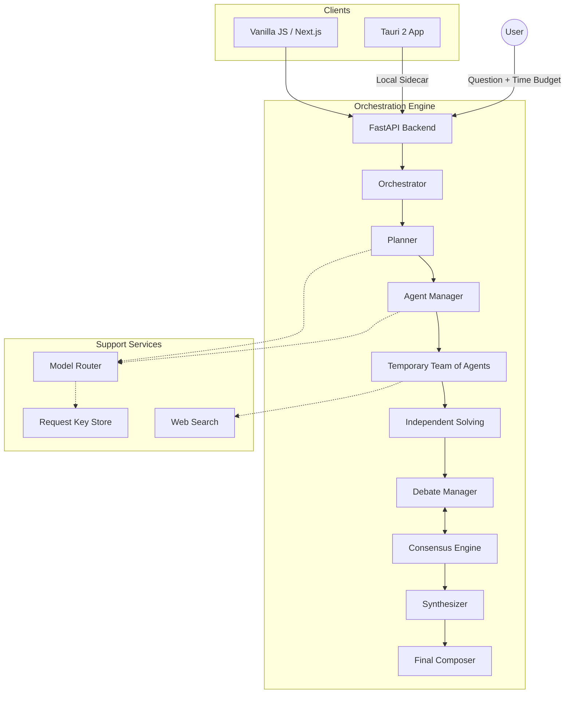
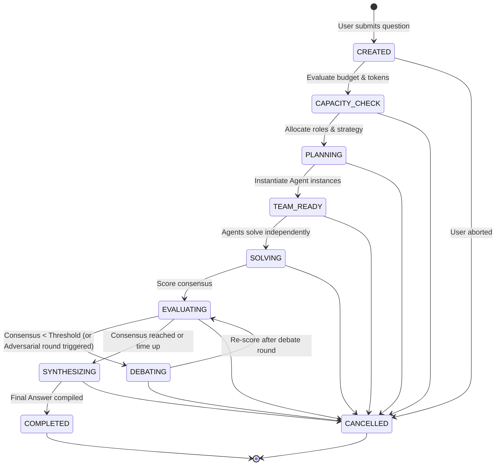

# Assembly Architecture

Assembly orchestrates a dynamic, temporary team of AI agents to answer complex user questions within a fixed time budget.

## Component Diagram

## Execution State Machine

The core `Orchestrator` relies on a strict state machine to manage the execution lifecycle. 

## Overview of Phases

1. **Capacity Check**: A heuristic evaluation of available rate limits and time. 
2. **Planning**: A planner agent classifies the problem complexity, determines if research is needed, and outputs a required team composition.
3. **Team Ready**: The Agent Manager instantiates diverse agents based on the plan. Diversity is strictly enforced by model family.
4. **Independent Solving**: Agents solve the question entirely independently to avoid groupthink.
5. **Evaluating / Debating**: The Consensus Engine evaluates answers based on agreement, confidence, evidence, contradiction, and stability. If consensus isn't reached (or if an adversarial strike is triggered to challenge premature consensus), a Debate Round runs where agents cross-examine each other.
6. **Synthesizing**: A synthesizer takes all arguments, debate history, and source references to compose a final output with an uncertainty note.
