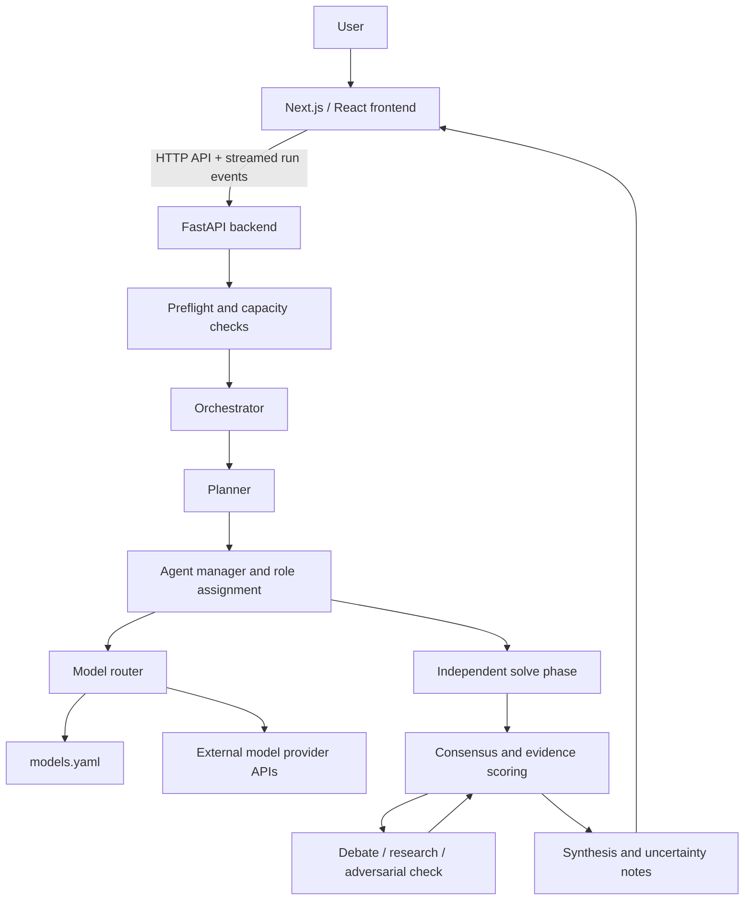

# Assembly architecture

Assembly coordinates a temporary team of AI agents around a user question and time budget. Agents first work independently, then compare evidence and disagreement, and finally synthesize a response with remaining uncertainty.

## Component overview

## Main components

| Component | Responsibility |
|---|---|
| `frontend/` | Next.js static-export frontend; user settings, provider-key configuration, execution controls, progress display, and results. |
| `src/main.py` | FastAPI app setup, middleware, health endpoints, and API router registration. |
| `src/api/` | HTTP endpoints for preflight, catalog, provider-key testing, run execution, event streaming, and cancellation. |
| `src/orchestration/` | Capacity checks, planning, temporary agent teams, independent solving, debate, consensus scoring, and synthesis. |
| `src/providers/` | Provider adapters, model routing, quota handling, mock/replay providers, and configuration validation. |
| `src/research/` | Search-provider routing plus bounded static-page fetching/extraction; web text is sanitized as untrusted evidence before prompt use. |
| `models.yaml` | Configured provider/model catalog, family/role assignments, and model-specific quota metadata. |
| `tests/` | Python unit/regression tests designed to use mock providers and local test fixtures. |
| `frontend/tests/` | Playwright browser regression tests. |

## Request lifecycle

1. **Preflight and capacity:** Assembly checks the requested budget and the models/quotas available to the caller.
2. **Planning:** a planner estimates the task and proposes roles and strategy.
3. **Team formation:** the router selects configured models, accounting for model families and available keys.
4. **Independent solving:** agents generate first-pass answers without seeing one another's responses.
5. **Consensus scoring:** the engine compares agreement, evidence, confidence, contradictions, and new information.
6. **Challenge rounds:** if needed and time remains, agents debate, research, or challenge premature agreement; the engine scores the result again.
7. **Synthesis:** a final answer is assembled with supporting sources and explicit uncertainty where possible. Runs may also end due to a time limit, cancellation, or provider failure.

A consensus score is a heuristic, not a calibrated probability that an answer is correct. Distinct model families may still share training data, incentives, or blind spots.

## Interfaces and events

The frontend calls FastAPI endpoints for the model catalog, preflight checks, key testing, and run execution. Run execution streams progress events to the browser; cancellation is exposed separately. The frontend API client in `frontend/src/lib/api-client.ts` is the best starting point for understanding request and event payloads. The backend route modules in `src/api/` define server-side behavior.

## Configuration and provider boundaries

Model IDs, family classification, roles, and quota metadata belong in `models.yaml`; do not duplicate them as hard-coded values in application code. Provider limits change over time. Verify changes against the provider's current dashboard or documentation and include a source/date note when updating configuration.

Normal tests should use mock or replay providers. Tests that need live provider access must be explicitly marked `@pytest.mark.live` and must not run as part of the default suite.

## Storage and secrets

- **Web mode:** designed not to persist questions, answers, or provider keys in a server database. Run coordination uses in-memory state; an in-memory run may still temporarily exist while it is executing.
- **Development and desktop modes:** use local SQLite for local history/state. Desktop integration may also use the operating system keyring.
- **Browser:** saved provider-key configuration can persist in browser storage. Treat it as sensitive local data and use trusted devices/builds.
- **Logs and tests:** keys must never be written to logs, URLs, fixtures, screenshots, or API responses. Keep redaction and key-leak regression tests intact.

Do not describe Assembly as end-to-end encrypted or as a guarantee of privacy. Provider APIs receive the data necessary to complete requests, and each provider's own terms and privacy practices apply.

## Where to make changes

- User experience and accessible UI: `frontend/src/`
- API behavior and request validation: `src/api/`
- Core execution pipeline: `src/orchestration/`
- Model/provider catalog and routing: `models.yaml`, `src/providers/`
- Regressions and deterministic fixtures: `tests/`, `frontend/tests/`

See [CONTRIBUTING.md](../CONTRIBUTING.md) for local setup, test commands, and the pull-request workflow.
